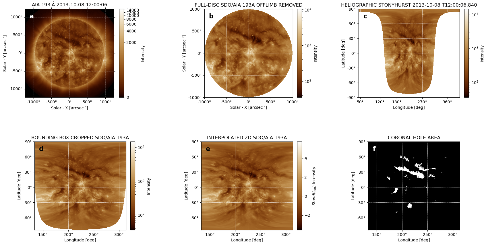

# HSS-SpeedNet-Model
> Prediction of High-Speed Solar Wind Streams using SDO/AIA EUV MAPs/BINARY Maps.
This is a follow up resource for our Research Publication.

---
## Table of Contents

- [About SpeedNet Model](#about-SpeedNet-Model)
- [SpeedNet Docker Image](#SpeedNet-Docker-Image)
- [Repository overview](#Repository-overview)
- [Docker Quick start](#Docker-Quick-start)
- [Citation](#Citation)
- [Github Files Description](#Github-Files-Description)
- [License](#license)
---

## About SpeedNet Model

The structure of the sun and it ability to influence the propagation of space plasma parcel, realised that different dynamo effect in the sun leads to the generation of solar wind in the interplanetary. The presence of CME (Coronal Mass Ejection) would lead to an abrupt change in the magnitude and effect of solar wind parcel in the interplanetary and near earth. Also, the presence of Coronal hole could create the CIR (Corotating Interaction region) and the SIR (Stream Interaction region), which distort and changes the flow, direction and the magnitude of the Solar wind parcel. This study therefore enacts the prediction of solar wind speed not associated with ICMEs (Interplanetary Coronal Mass Ejection) strictly from Solar atmospheric Imagery. 


---

## SpeedNet Docker Image

**Deep-learning based prediction of high-speed solar wind streams strictly from solar atmosphere imagery, packaged as a ready-to-run Docker image.**

Docker Hub: [`jjaalowonle/the_speednet`](https://hub.docker.com/r/jjaalowonle/the_speednet)

This work accompanies the paper:

> *Deep Learning-Based Prediction of High-Speed Solar Wind Streams: Spatio-Temporal Dependencies in Coronal Hole Dynamics.*
> Earth and Space Science. DOI: [10.1029/2025EA004523](https://doi.org/10.1029/2025EA004523) ([article](https://agupubs.onlinelibrary.wiley.com/doi/abs/10.1029/2025EA004523))

---

## Repository overview

### What the image does

The image bundles the SpeedNet code and its environment, so you can reproduce the predictions without installing Python, TensorFlow/Keras or any dependencies. It predicts the **solar wind speed 1 to 5 days ahead** from solar images, compares it with the observed speed, and writes metrics, time series and plots to your computer.

| Model | Input |
|---|---|
| **SpeedNet-BM** (option 1) | Processed binary coronal hole images |
| **SpeedNet-EUV** (option 2) | Processed multiwavelength EUV images from SDO/AIA at 193 Å, 171 Å and 304 Å |

You choose the model, the **delay** (1 to 5 days) and the **time resolution** (daily or hourly). You can run a single model or a five-fold cross-validation ensemble, with or without explainability (Grad-CAM and Integrated Gradients).

### What is in the Zenodo archive

The large files are not inside the image. They are hosted in one Zenodo record, [10.5281/zenodo.24564751](https://doi.org/10.5281/zenodo.24564751), and fetched on demand by the container.

| File | Contents | Downloaded |
|---|---|---|
| `models.zip` | The frozen trained models across the full solar cycle training period, as described in the paper | Automatically, if `models/` is empty |
| `data.zip` | Daily and hourly Richardson and Cane ICME processed catalogues (CSV), June 2020 to July 2025 | Optional (y/N prompt) |
| `Image_data.zip` | Processed SpeedNet-BM binary images, and SpeedNet-EUV processed multiwavelength AIA images (193 Å, 171 Å, 304 Å), 25 May 2020 to 31 August 2025 (~1.4 GB) | Optional (y/N prompt) |

---

## Docker Quick start

You only need [Docker](https://docs.docker.com/get-docker/) installed. The image is public, so no login or account is required.

### Linux / macOS (or Git Bash on Windows)

Download `run.sh` from this repository into an empty working folder, then:

```bash
bash run.sh
```

`run.sh` creates the folders, pulls the latest image and starts the container. It is equivalent to:

```bash
mkdir -p Image_data data models results
docker run --rm -it \
    -v "$(pwd)/Image_data:/app/Image_data" \
    -v "$(pwd)/data:/app/data" \
    -v "$(pwd)/models:/app/models" \
    -v "$(pwd)/results:/app/results" \
    jjaalowonle/the_speednet:latest
```

### Windows (PowerShell)

```powershell
mkdir Image_data, data, models, results -Force
docker run --rm -it `
  -v "${PWD}\Image_data:/app/Image_data" `
  -v "${PWD}\data:/app/data" `
  -v "${PWD}\models:/app/models" `
  -v "${PWD}\results:/app/results" `
  jjaalowonle/the_speednet:latest
```

### Windows (Command Prompt)

```bat
mkdir Image_data data models results
docker run --rm -it ^
  -v "%cd%\Image_data:/app/Image_data" ^
  -v "%cd%\data:/app/data" ^
  -v "%cd%\models:/app/models" ^
  -v "%cd%\results:/app/results" ^
  jjaalowonle/the_speednet:latest
```

To pin a release, use `jjaalowonle/the_speednet:1.0.0` instead of `latest`.

> **Note:** Do not add `:ro` (read-only) to the mounts on the first run, because the container needs to write the downloaded files into them.

### What happens on the first run

1. **Models are downloaded automatically** (`models.zip`) and unzipped into `models/`.
2. You are asked:
   ```
   Download the catalogue data (data.zip) too? [y/N]
   Download the processed image data (Image_data.zip, ~1.4 GB) too? [y/N]
   ```
   Answer `y` to download and unzip into `data/` or `Image_data/`. Press Enter to skip.
3. The SpeedNet session starts and asks for your choices.

The folders are mounted from your computer, so downloads happen once. Nothing is fetched again if the folder already has content. If you pass options on the command line (see below), the two questions are skipped. Add `-e FETCH_DATA=y -e FETCH_IMAGES=y` to download them anyway.

---

## Using SpeedNet

### Interactive session

Started with `-it` and no options, SpeedNet asks, in this order:

1. **Model**: 1 = BM, 2 = EUV
2. **Time resolution**: daily or hourly
3. **Data locations**: "Use these default locations? [Y/n]". Answer `n` to type your own paths (Enter keeps a default).
4. **Fold or no fold**: run the cross-validation fold models for the delay you choose next
5. **Delay**: 1 to 5 days
6. **Explainability**: XAI or no XAI

### Command-line options

Passing an option skips the matching question. Without `-it`, `--option` and `--delay` are required.

```bash
docker run --rm -it ... jjaalowonle/the_speednet:latest --option 2 --delay 4 --cadence daily
```

| Option | Meaning | Default |
|---|---|---|
| `--option` | 1 = BM, 2 = EUV | asked |
| `--delay` | Prediction delay in days (1 to 5) | asked |
| `--cadence` | `daily` or `hourly` | `daily` |
| `--images-dir` | Folder with the FITS images | `Image_data/SpeedNet_BM_Image` (option 1) or `Image_data/SpeedNet_EUV_Image` (option 2) |
| `--solar-wind` | Solar wind speed CSV | `data/solar_wind_processed_speed_June_2020_July_2025.csv` |
| `--icme` | ICME catalogue CSV | `data/Daily_Richardson_cane_icme_catlog_2020_2025.csv` |
| `--daily-hour` | UT hour of the daily image | `12` |
| `--icme-filter` | `both`: drop a sample if the image time or the arrival time is inside an ICME. `arrival`: arrival time only | `both` |
| `--folds` | Run the five cross-validation fold models | off |
| `--fold-results-dir` | Where fold outputs are written | `results/Result_Fold_model/` |
| `--hse-mode` | `segments` or `concat` (see Metrics) | `segments` |
| `--min-segment` | Minimum run of consecutive days in `segments` mode | `5` |
| `--min-hours-per-day` | Hourly data: minimum valid hours for a day to count | `18` |
| `--batch-size` | Prediction batch size | `32` |
| `--xai` | Switch on explainability | off |
| `--xai-steps`, `--xai-max`, `--xai-from`, `--xai-to`, `--xai-png`, `--xai-last-conv` | Explainability settings (see below) | see below |

Relative paths are relative to `/app` inside the container, so `--images-dir my_images/set2` means `/app/my_images/set2`.

### Using your own data

Docker cannot see Windows paths such as `C:\Users\...`. Mount the folder with `-v` and use the container path:

```bash
docker run --rm -it \
  -v "$PWD/my_hourly:/app/my_hourly:ro" \
  -v "$PWD/models:/app/models" \
  -v "$PWD/results:/app/results" \
  jjaalowonle/the_speednet:latest \
  --option 1 --delay 2 --cadence hourly \
  --images-dir my_hourly/images \
  --solar-wind my_hourly/sw_hourly.csv \
  --icme my_hourly/icme_hourly.csv
```

On Windows PowerShell, replace `"$PWD/my_hourly:..."` with `"D:\my_hourly:/app/my_hourly:ro"` and the line endings `\` with a backtick.

Without Docker, you can also run `python app/run_speednet.py ...`, where normal `C:\...` paths work too.

### How model files are picked

| Mode | Files used |
|---|---|
| **No fold** | `SpeedNet_<BM\|EUV>_Model_Delay_<d>.keras`, loaded directly (a file or a folder; an unambiguous alternative name containing the model tag and `delay_<n>` is also accepted) |
| **Fold** | `SpeedNet_<BM\|EUV>_Model_Fold_<k>_Delay_<d>.keras` for k = 0 to 4 |

In fold mode:

- If one fold's file is missing, that fold is taken to be the best model and `SpeedNet_<BM|EUV>_Model_Delay_<d>.keras` is used in its place. A line such as `fold 2 of delay 2 is stored as SpeedNet_BM_Model_Delay_2.keras` is printed, and you always get 5 models.
- If all five fold files are present, they are used and the plain file is ignored.
- If two or more folds are missing, or one is missing and the plain file is not there either, the run stops with a clear message before any model runs.

Both model sets can sit in the same `models/` folder. Models load with `compile=False`.

<details>
<summary><b>Input file formats</b></summary>

**Images.** FITS files named `AIAYYYYMMDD_HHMM.fits` (for example `AIA20201004_1200.fits`). The date and time are the solar *source* time.
- BM: shape `(256,256)` or `(256,256,1)`, values 0 or 1.
- EUV: shape `(256,256,3)` (193, 171, 304 Å, standardized).
- Images with NaN/Inf values or a wrong shape are skipped and reported.

**Cadence.** You supply data at the cadence you choose, and the program adapts the mapping and the ICME removal:

| | daily | hourly |
|---|---|---|
| Images | one per day: the one closest to 12 UT (`--daily-hour`) | one per hour: image time rounded to the nearest hour |
| Solar wind CSV | `date` (YYYYMMDD) or `datetime`, plus the speed column `SW_Speed(Km_s)` | `datetime` **with the hour** (e.g. `2020-06-01 05:00`), or `date` plus an `hour` column |
| Forward mapping | arrival day = image day + delay days | arrival hour = image hour + delay days (the delay is always in **days**) |
| ICME removal | a day is removed if it lies in an ICME | an hour is removed if it lies in an ICME (a date-only list removes all 24 hours of each listed day) |

**ICME CSV.** Two layouts, detected automatically:
1. *Event list*: columns `Start_time,End_time`, in the format `YYYY/MM/DD HHMM` (for example `2020/01/04 1000`).
2. *Time list*: one column (`date`, `datetime`, or the first column) with every ICME **day** (`2020-07-04` or `20200704`) or every ICME **hour** (`2020-07-04 10:00`). A daily list with hourly cadence flags whole days. An hourly list with daily cadence flags every day that contains an ICME hour.

</details>

---

## Outputs

Everything is written to `results/`, which persists on your computer. File names start with `SpeedNet_<BM|EUV>_delay<d>_<daily|hourly>_`.

| File | Contents |
|---|---|
| `prediction_timeseries.csv` | `date` (YYYYMMDD of arrival), `datetime` (arrival time), `Observed`, `Prediction`, image name and time |
| `metrics.csv` | `Model, RMSE, Correlation, Threat_Score`, then `N_samples, MAE, RMSE_error, Corr_p_value, TP, FP, FN, Cadence, HSE_basis` |
| `plot.png` | (a) time series with HSE shading and black ICME bars (gaps where ICME times were removed); (b) scatter with linear fit |

### Metrics

- RMSE and Pearson correlation use the data at the chosen cadence.
- **Threat score** = TP / (TP + FP + FN), computed with `hsemetric.BatchwiseHSE(observed, predicted)`. A high-speed enhancement (HSE) is a +50 km/s rise from one daily value to the next, so `hsemetric` works on **daily** speeds. For hourly data, the hourly values are first averaged to daily means (days with fewer than `--min-hours-per-day` valid hours are dropped), and `HSE_basis` in `metrics.csv` says which was used.
- Removing ICME days leaves gaps. `--hse-mode segments` (default) scores blocks of consecutive days (at least `--min-segment`) and sums TP/FP/FN, so a jump across a gap is never counted as an HSE. `concat` glues the remaining days together, and the threat scores can differ.

### Fold mode outputs

Answer `y` to the cross-validation question and SpeedNet runs Fold_0 to Fold_4 for the chosen delay on the same ICME-filtered samples.

- `results/Result_Fold_model/`: per-fold time-series CSV, metrics CSV and plot, for example `SpeedNet_BM_fold0_delay3_daily_plot.png`. A fold taken from the plain-named file is still labelled by its fold number (for example `fold2`).
- `results/Result_Fold_model/mean/`: results averaged over folds:
  - `*_metrics_mean_over_folds.csv`: mean and standard deviation of each metric
  - `*_all_folds_metrics.csv`: one row per fold
  - `*_ensemble_prediction_timeseries.csv`: the averaged prediction (y0+y1+y2+y3+y4)/5, plus each fold's prediction in `Prediction_fold<k>` columns and the spread between folds
  - `*_ensemble_metrics.csv` and `*_ensemble_plot.png`: metrics and plot for the ensemble

To write fold output elsewhere, pass `--fold-results-dir`. Keep it inside a mounted folder, because anything written outside the mounts is lost when the container exits (`--rm`).

### Optional: explainability (Grad-CAM and Integrated Gradients)

Switch it on with `--xai`, or answer `y` to the question.

- **Grad-CAM** on `max_pooling2d_3` (`--xai-last-conv`; it falls back to the last MaxPooling2D or Conv2D layer), with `class_index = argmax(output)`.
- **Integrated Gradients** with 50 steps (`--xai-steps`) and a pixel-shuffled baseline (seed 42).
- Limit the work with `--xai-max N`, `--xai-from` and `--xai-to`. `--xai-png` adds quick-look figures.
- Each sample needs 1 Grad-CAM pass and 50 IG passes, so try a small `--xai-max` first.

Saved in `results/XAI/SpeedNet_<BM|EUV>_delay<d>_<cadence>/`: `Gradcam/`, `IG/`, `Input/` (`YYYY_MM_DD.npy` by image date; hourly: `YYYY_MM_DD_HH.npy`), `xai_index.csv`, and optional `png/`.

---

## Folder layout

```
your-working-folder/
├── run.sh
├── Image_data/
│   ├── SpeedNet_BM_Image/     binary maps, AIAYYYYMMDD_HHMM.fits   (option 1)
│   └── SpeedNet_EUV_Image/    3-channel EUV, AIAYYYYMMDD_HHMM.fits (option 2)
├── data/                      solar wind CSV and ICME catalogues (daily and hourly)
├── models/                    SpeedNet_<BM|EUV>_Model_Delay_1..5.keras (and fold files)
└── results/                   all outputs are written here
```

---

## Manual download (no Docker)

```bash
curl -L -o models.zip     "https://zenodo.org/records/24564751/files/models.zip?download=1"
curl -L -o data.zip       "https://zenodo.org/records/24564751/files/data.zip?download=1"
curl -L -o Image_data.zip "https://zenodo.org/records/24564751/files/Image_data.zip?download=1"

unzip models.zip     -d models
unzip data.zip       -d data
unzip Image_data.zip -d Image_data
```
---

## Citation

If you use SpeedNet, the models or the data, please cite the paper:

> *Deep Learning-Based Prediction of High-Speed Solar Wind Streams: Spatio-Temporal Dependencies in Coronal Hole Dynamics.* Earth and Space Science. https://doi.org/10.1029/2025EA004523

and the Zenodo record: https://doi.org/10.5281/zenodo.24564751

## Github Files Description

Find in this repo the files used for the analysis:

1. Process the Solar wind speed using SW_Processing.
2. Process the Maps using Image_Preprocess.
3. Perform the Analysis:
    - a. SpeedNet_EUV for the Three Channel EUV Model.
    - b. SpeedNet_BM for the Binary Map Model.
4. HSEMETRIC contains metrics for analyzing the Threat Score.
5. To observe the Activation of the Model, utilize HSS ACtivation metrics.
6. For Visualizing the Model Plot:
    - HSS_Activation - HSSs_Activation_comparison_Analysis.
    - Timeseries and GradCam for SpeedNet_BM and SpeedNet_EUV.
---


## License

This project is licensed under the MIT License. See the [LICENSE](./LICENSE) file for details.
"# HSS-SpeedNet-Model" 
"# HSS-SpeedNet-Model" 

